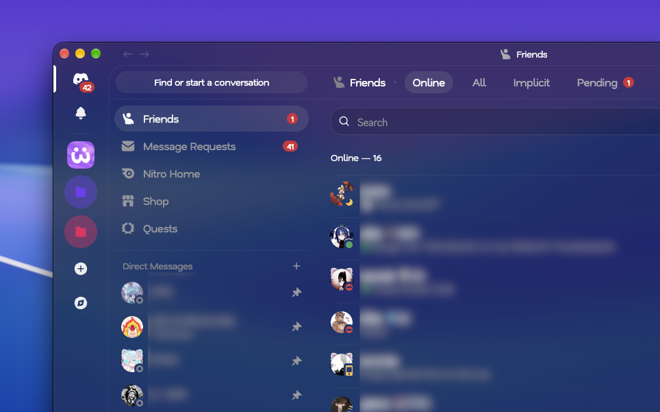
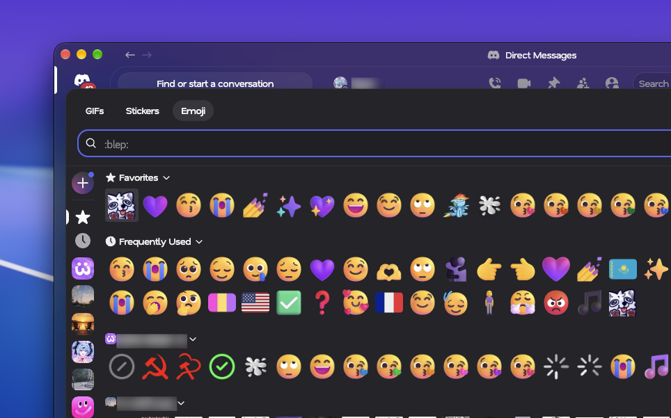
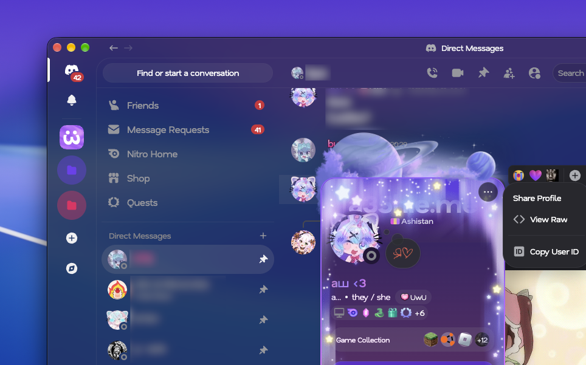
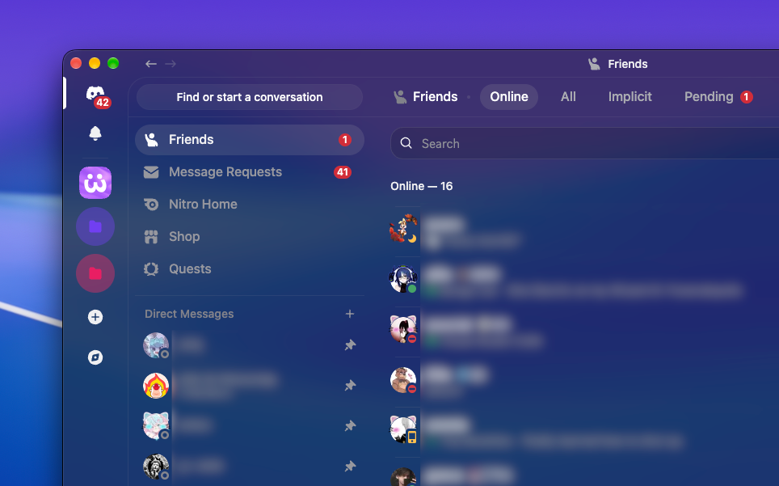

# Discord CSS Modifications

A collection of home-made Discord CSS mods for the redesigned Discord desktop client.
For full documentation, go to [my Guides page](https://guides.a35hie.me/themes/web/discordThemes).
> You will need a Discord client mod to use these styles. Check out [Vencord](https://vencord.dev).


## Transparency
Makes the Discord UI transparent.



Also, be sure to check out Demureify and Semi-transparent main that were designed to improve this theme.

> You can get translucency on macOS with [Vencord](https://vencord.dev).

```
https://dmods.a35hie.me/Transparency.css
```

### Enhancements
#### Semi-Opaque Main
Makes the main content slightly darker to contrast the transparent outer level.

```
https://dmods.a35hie.me/SemiOpaqueMain.css
```

#### Demureify
Makes elements that are opaque, less opaque with Transparency.

```
https://dmods.a35hie.me/DemureifyNonTransparent.css
```

## Beeg GIF/Emoji/Sticker Picker
Enlarge the emoji/GIF/sticker picker.




```
https://dmods.a35hie.me/Big-GIF-Emoji-Sticker-Picker.css
```

## More Rounded Corners
Gives some elements more rounded corners.



```
https://dmods.a35hie.me/MoreRoundedCorners.css
```

## System Fonts
Use your platform's system font instead of Discord's.


```
https://dmods.a35hie.me/SystemFonts.css
```

---
Notice: I am not connected to or affiliated with personally to Discord nor Vencord. 
Use client mods at your own risk.
